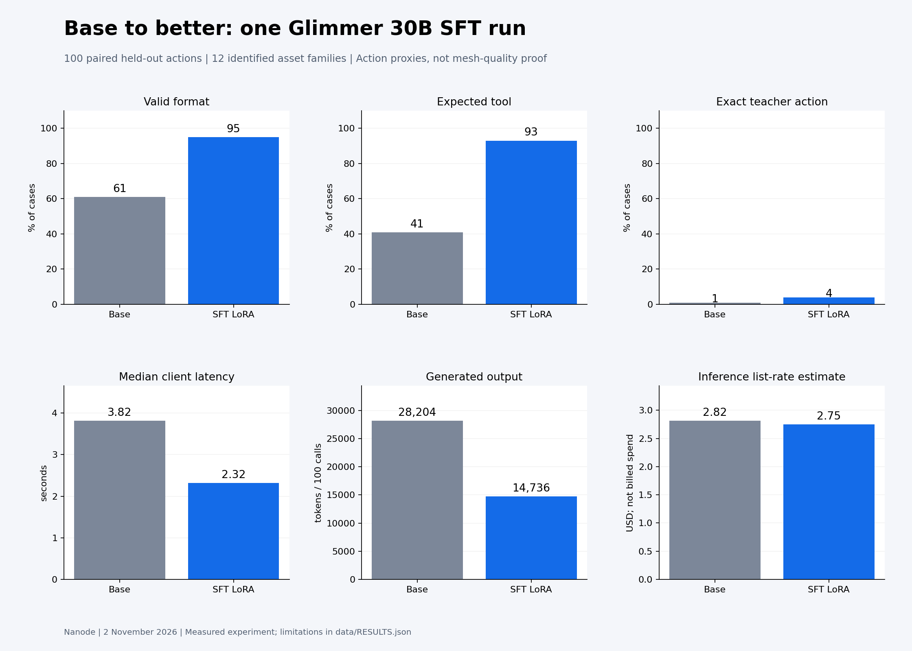

# Nanode hackathon: Glimmer SFT findings

Presentation handoff for November 2, 2026. Start with [CLAUDE_HANDOFF.md](CLAUDE_HANDOFF.md).

**Measured:** better next-action formatting and tool agreement, with lower observed response latency. **Not achieved:** an exported 3D mesh from either model. Every requested first/fifth mesh comparison is missing.

| Held-out metric | Base | LoRA |
|---|---:|---:|
| Valid action format | 61% | 95% |
| Expected next-tool agreement | 41% | 93% |
| Exact recorded-action match | 1% | 4% |
| Median client latency | 3.82 s | 2.32 s |
| p95 client latency | 19.33 s | 9.89 s |
| Output tokens, 100 requests | 28,204 | 14,736 |
| Uncached list-rate estimate, 100 requests | $2.817 | $2.751 |

The test contains 100 paired cases from 12 identified asset families. All 200 requests returned. Action metrics are not mesh quality or complete-task success. Lower output volume accompanies lower latency; decoding speed was not measured. The exact-action family-bootstrap interval crosses zero. Family groups are disjoint across splits; perceptual/source independence was not certified.

## Package

- `charts/`: eight figures in PNG and editable SVG.
- `data/RESULTS.json`: canonical structured findings, recipe, failures, dimensions and limitations.
- `data/paired_cases.csv`: 200 anonymized numeric observations for replots.
- `data/`: stage, training, split, mesh-attempt and rubric tables.
- `docs/`: data dictionary, high-level method and composite-asset brief.
- `SLIDE_OUTLINE.md`: chart-first presentation sequence.

No production code, raw demonstrations, prompts, generated action text, source assets, model weights, credentials, account details or private endpoints are included. No 3D asset is included because none was exported.

The SFT job completed one epoch of rank-8 LoRA on Muse Glimmer 30B, using 597 training examples and a separate 50-example validation partition. Training completed in 14m58s. The final checkpoint was frozen before the held-out comparison. See the data dictionary for exact metric meanings and limitations.

## Working with the data

All figures and numeric tables are already generated; no API key or model access is needed. Use the SVGs for presentation layout and CSV/JSON files for new charts. Preserve missing values and the distinction between estimated costs, reserved budget and billed spend.
